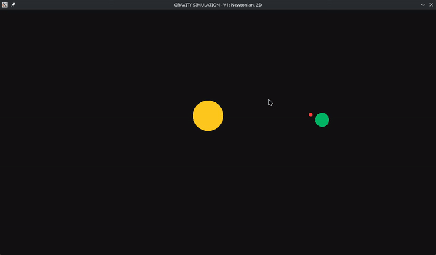

# Newtonian Gravity Simulation

A 2D Newtonian gravity simulation built with C and raylib.



## Build and run

Requires CMake 4.2 or newer and a C17-compatible compiler. The project includes raylib in `vendor/RAYLIB`.

```sh
cmake -S . -B build
cmake --build build
./build/src/GRAVITY
```

## Controls

- **W/A/S/D**: Move the view
- **P**: Zoom in
- **M**: Zoom out

See the [design document](docs/design.md) for the architecture and design decisions, and the [world API reference](docs/world-api.md) for the public world functions.